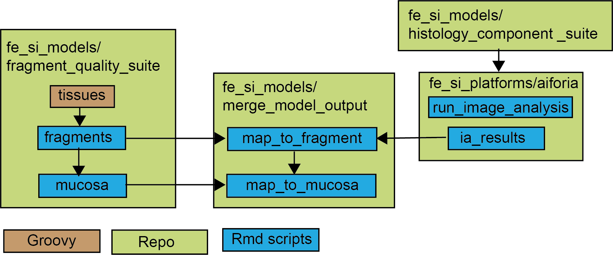

## Objective
This repository is a way to collect information on different AI models developed
for analyzing feline small intestinal biopsies. Each ai model has a folder, 
that for the more complex models contains it's own README on model objectives & 
intended use, links to slide decks with SOPs, info on model type and platform, 
training, tuning and testing strategies and case material used for development 
and testing.

### Fragment-quality suite
- **tissues** (classic ML, qupath, input for fragments)
- **fragments** (rule-based)
- **mucosa** (rule-based)

### Histology-component suite
These are all developed in aiforia. Model versions and project versions 
(and previous names if applicable) are tracked here: 
https://docs.google.com/spreadsheets/d/1Bg5ZT4h1TjjKgKP76iZ03OzNSspau0jlSxPWKsOVVXw/edit?usp=sharing
- **layers** (CNN, aiforia, combined with compartments (parent to) and 
lymphocytes in aiforia)
- **compartments** (CNN, combined with layers (child to) and lymphocytes 
(parent to) in aiforia)
- **lymphocytes** (CNN, aiforia, combined with layers (grandchild to) and 
compartments (child to) in aiforia)

### Merge_model_output
- **map_to_fragment** (script that maps layers, compartment and lymphocytes output
to specific fragments)
- **map_to_mucosa** (script that maps layers, compartments and lymphocytes to specific
mucosal segments)

### Historic
contains models and files not currently in use - kept for documentation only
- **content_vs_background** (rule based, predecessor to "tissues")
- **scraped_aiforia_data_2021**

