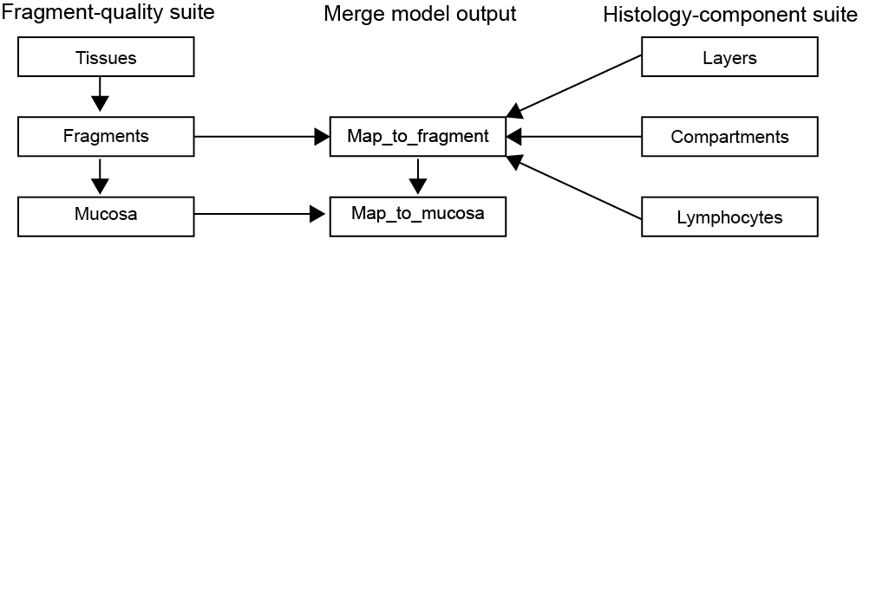

## Objective
This repository is a way to collect information on different AI models developed
for analyzing feline small intestinal biopsies. Each ai model has a folder, 
that for the more complex models contains it's own README on model objectives & 
intended use, links to slide decks with SOPs, info on model type and platform, 
training, tuning and testing strategies and case material used for development 
and testing.

For aiforia models, model versions and project versions are tracked here:
https://docs.google.com/spreadsheets/d/1Bg5ZT4h1TjjKgKP76iZ03OzNSspau0jlSxPWKsOVVXw/edit?usp=sharing

### Histology-component model suite
- **layers** (CNN, aiforia, combined with compartments (parent to) and 
lymphocytes in aiforia)
- **compartments** (CNN, combined with layers (child to) and lymphocytes 
(parent to) in aiforia)
- **lymphocytes*** (CNN, aiforia, combined with layers (grandchild to) and 
compartments (child to) in aiforia)

### Fragment-quality model suite
- *content_vs_background* (rule-based, qupath, predecessor to tissues - not in use)
- **tissues** (classic ML, qupath, input for fragments)
- **fragments** (rule-based fusion model)
- **mucosa** (rule-based fusion model)

### Merging model output steps
- **map_to_fragment** merging step where DL model output is maooe
- **map_to_mucosa** merging step

