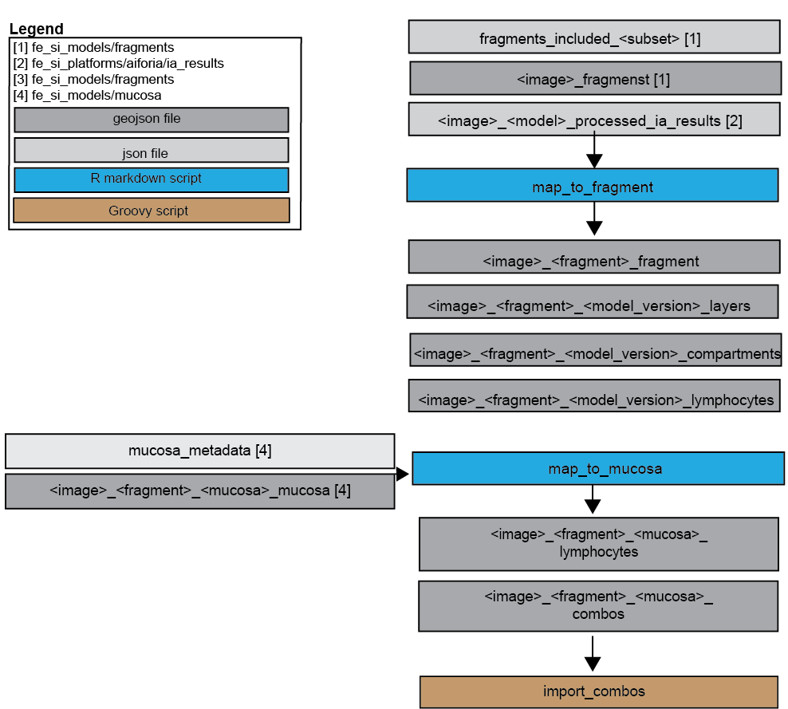

## Objective
AI models developed in aiforia can be chained into combination models (within aiforia). 
This can be cheaper and more efficient to run (the cost structure is uninterpretable). 
This folder contains documentation for feline small intestinal combination models
and scripts to map downloaded aiforia output for the combination models to 
tissue fragments and small intestinal mucosa. 

SOP for combining models in aiforia:
https://docs.google.com/presentation/d/1TfTqYD7IXBNtEB0yTfHjLSWQN352mR_C/edit?usp=sharing&ouid=114290326180405247455&rtpof=true&sd=true

Different combination models (including which original models were combined are listed here):
https://docs.google.com/spreadsheets/d/1Bg5ZT4h1TjjKgKP76iZ03OzNSspau0jlSxPWKsOVVXw/edit?usp=sharing
(Subsheet "fe_si_combos" - also downloaded xlsx sheet in folder "development")

## Scripts
- **map_to_fragment.Rmd**
Maps output downloaded and processed with aiforia (fe_si_platforms/aiforia) to
fragments processed with fragments (fe_si_models/platforms)

- **map_to_mucosa.Rmd**
Maps output processed with map_to_fragments (herein) to
mucosa processed with mucosa (fe_si_models/mucosa)

- **import_mucosa_combos.groovy**
Imports combos mapped to mucosa to QuPath project

## Deviations/ issues/ comments
The folder "historic_version" subfolder "combos" contains similar output as map_to_fragment
with minor variations in label and class names, the subfolder "mapped_ai_output
contains output for an earlier version of "map_to_mucosa" w other fragment model
paramters etc. Similarly "Input" contains an excel with manual assessment of the mucosa with
pilot assessment of ai performance. Scripts contain a previous attempt to 
filter FP lymphocytes in epithelium based on size (unsuccess	ful) Keep for traceability for now.