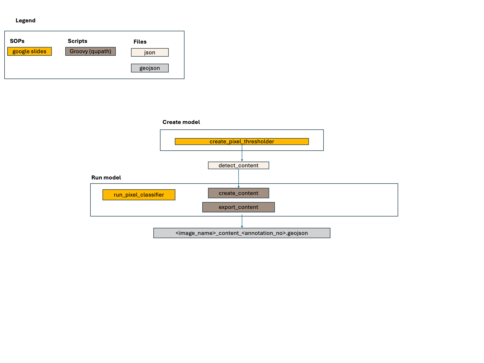

## Objective 
Separate area of any content from background - to serve as a base for random rois
used to validate tissue_vs_glass (fe_si_models/tissue_vs_glass)

## Model architecture
- Pixel thresholder

## Classes
- content

## Model development
SOP: https://docs.google.com/presentation/d/1XTb9_OsEHadeK00zn1mO5zQvz4I9exASDEQFf6HTTNY/edit?usp=sharing

### Software
QuPath v0.5.1

### Hardware
JUDITS_PC Specs here: 
https://docs.google.com/spreadsheets/d/1Ue-r-fvt8fJIE0h0DGZL6AWinbydgwbYKjDaHcTdx3k/edit?usp=drive_link

