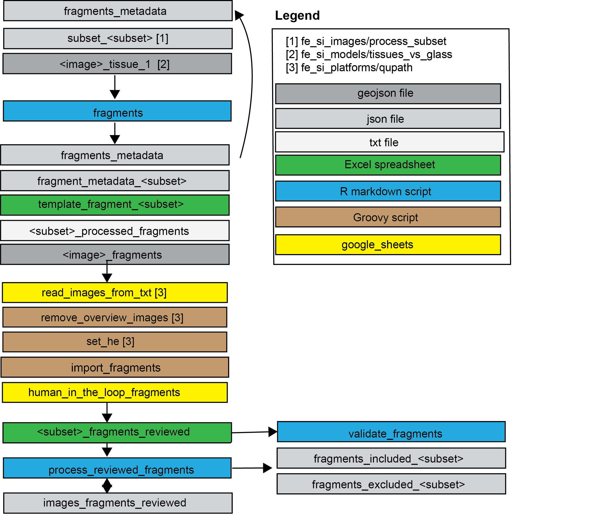
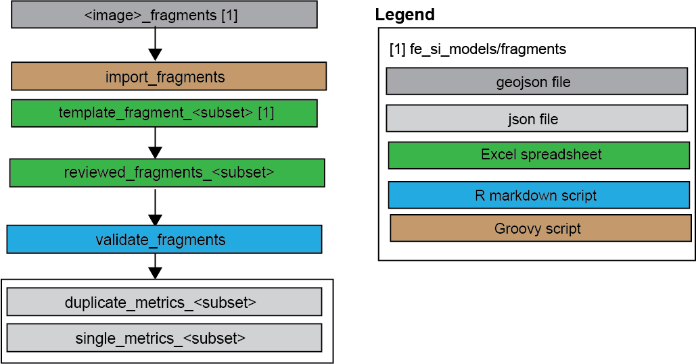

## Objective 
Identify different tissue fragments on a wsi and label them for inclusion or 
exclusion (if duplicates).

## Model type
This is not a ML-model but a rule-based model taking tissue polygons generated 
by "tissue_vs_glass" as input and outputting fragment polygons. 

## Workflow
This is meant to be a human-in-the-loop model, with the human going over the output
in qupath and marking fragments for correction of original vs duplicates and exclusion.
In the current workflow, output fragments are read into qupath, evaluated manually
and processed with scripts for validation (**validate_fragments**) and sorting into 
inclusion vs exclusion (**process_reviewed_fragments**)

## Methods
A method sections is drafted here: 
https://docs.google.com/document/d/1jJiulCyo1aBEH6jpCA8k-zN5qQgVEA5NSLJZV6OLXII/edit?usp=drive_link

## Subfolders

### Scripts
- **fragments.Rmd**
Main script - processes tissue polygons to fragments
- **import_fragments.groovy** 
Imports fragments to qupath
- **import_fragments_lenovo_.groovy** 
Imports fragments to qupath - modified to be run on JMWs lenovo
- **validate_fragments**
This script assess fragment performance (mainly for identifying duplicates, 
although ability to separate fragments also assessed in tuning set)
- **process_reviewed_fragments**
This script cleans up human reviewed fragments and outputs lists of inclusion and exclusions.

### Output
In addition to one output folder per script, this also contains a folder
"fragments_reviewed" with manually reviewed fragments (documented in google drive
and downloaded here)

## Training & tuning
Parameters for the model were set by testing different settings in the images 
from labl_2020 (https://github.com/ucdavis/fe_si_samples/tree/main/labl_2020)
Training sets batch 1-3 were used for initial parameter setting and the tuning set
for visual assessment.

Validation outline is here:

