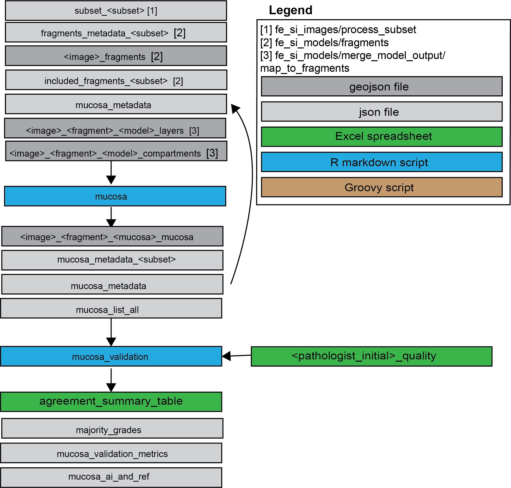

## Objective 
Identify mucosal regions in fragments of small intestine, 
and classify them based on orientation and artefact.

## Model type
This is not a ML-model but a rule-based model taking tissue polygons generated 
by "fragments", 
"layers", and "compartments" as input and outputting classified mucosa polygons.

## Scripts
- **mucosa_.Rmd**
This script processes fragments to mucosa, and classifies them based on
orientation and artefact
- **mucosa_validation**
Validates orientation and artefact classification against majority annotations
of three pathologists (stored in "input")
- **import_mucosa.groovy** 
This script imports fragments to qupath (run for project)
(separate version for lenovo)

## Development
Parameters for the model were set by testing different settings in the images 
from labl_2020 tuning set for visual assessment.

## Comments / Deviations / Issues
- Not good differentiation between non small intestine and some other organs.
I use a human-in-the-loop approach to filter non-si fragments prior to application
- Based on preliminary assessment of labl_tuning_set - differentiation between 
adequate and marginal orientation is suboptimal, but filters out inadequate 
orientation well. For artefact it is over sensitive for inadequate, but reasonably
specific. 
- The folder 'historic_versions' contains earlier script version when orientation (si_mucosa)
and artefact classification were separate scripts. 