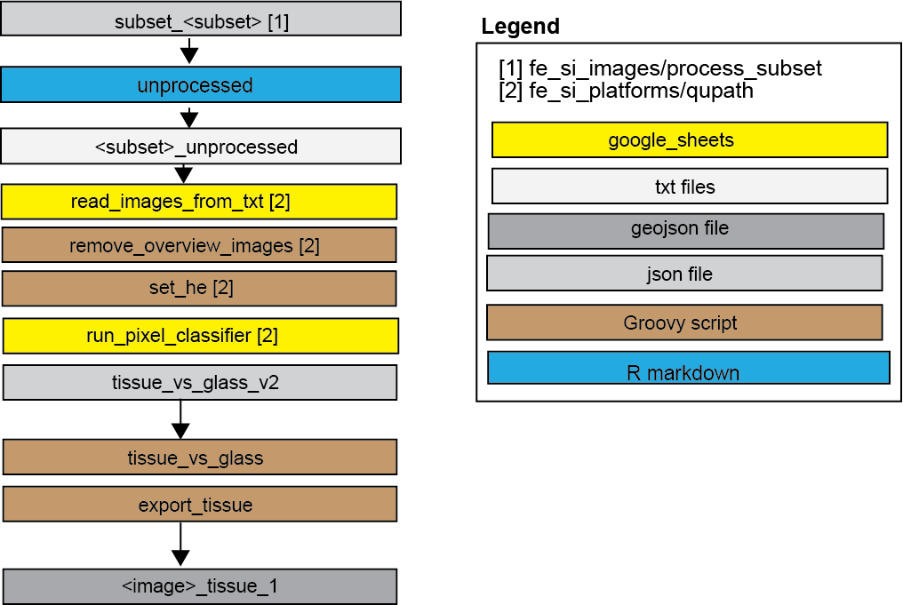

## Objective 
Separate area of a WSI with tissue (of any kind) "tissues" from areas with glass (including
empty glass, pen markings, stain droplets etc) "glass"

## Intended use
- Serve as a base for separating tissue fragments (fe_si_models/fragments)

A SOP for how to run the classifier is here:
https://docs.google.com/presentation/d/1g6dqdjK_-pD9KiYy0RF5K494eTH6i4Gg0Zym6BH708c/edit?slide=id.p#slide=id.p

## Model architecture
- Multi-layer perceptron (MLP) (a shallow artificial neural network ANN) 
- Semantic segmentation (pixel classifier)

## Model development
- SOP: <https://docs.google.com/presentation/d/1g9QMLUlkV8ITmbK1x9Ol7yW0G8M7sXVrNF_m_vysnBk/edit?usp=drive_link>
Developed using labl_2020 training batch 1&2 (training) and labl_2020 tuning (full)
see "fe_si_samples" for sample info.
- Software & hardware: QuPath v0.5.1 on JUDITS_PC Specs here: 
https://docs.google.com/spreadsheets/d/1Ue-r-fvt8fJIE0h0DGZL6AWinbydgwbYKjDaHcTdx3k/edit?usp=drive_link
- Hyperparameters & model_versions:
https://docs.google.com/spreadsheets/d/14arTrgun_KB4gPumhx4ZE5X8JcgudXyupEgvB8jFlgA/edit?usp=sharing
- Tuning assessment: https://docs.google.com/spreadsheets/d/1uXLYJ0KbuQHwRvG_OOtYaGBr4jlTv9TtmFlvYeLK7-4/edit?usp=sharing 
- M&M draft: https://docs.google.com/document/d/1Lni-o9eW2jZ4UXC-QhvEW9tEqqR1mb3KGefZJwLDfKw/edit?usp=sharing

## Subfolders
- **annotations** contains all training annotations
- **models** contains model (only v2 retained)
- **scripts** 
  - **tissue_vs_glass.groovy**: runs classifier (needs to be copied from "models" into
  <qupath_project>/classifiers/pixel_classifiers/ first)
  - **export_tissues.groovy**: Exports results as geojsons (sep version for lenovo)
- **output**: output geojsons

## Issues / comments / To do
- FN in areas of lipid or pale submucosa & FP in areas of stain precipitate
Not a problem for small intestinal mucosa but should be updated if analyzing deeper 
intestinal layers or other tissue.
- Not quantitatively assessed, not validated on test set
- Analysis failed in one image - suspected corrupt image files. Failed analyses 
are tracked (manually) here https://docs.google.com/spreadsheets/d/1oU9rc0JaMXNEJQ6CvPHMHYumQAyUP3x8ylf22a84s9Q/edit?usp=sharing