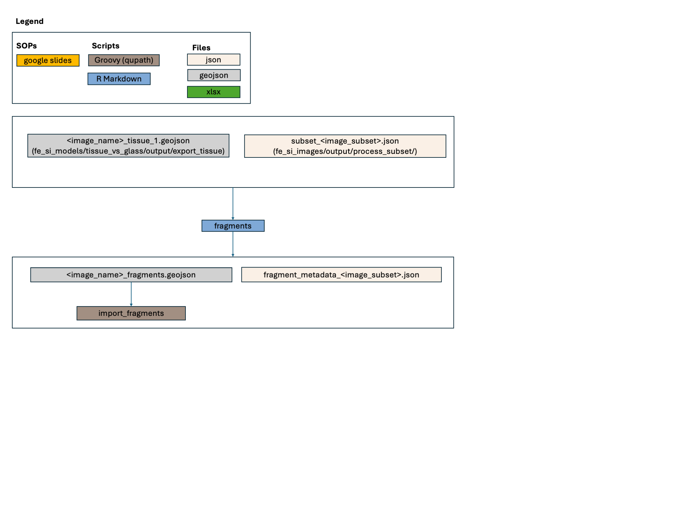

## Objective 
Identify different tissue fragments on a wsi and label them for inclusion or exclusion (if duplicates)

## Model type
This is not a ML-model but a rule-based model taking tissue polygons generated 
by "tissue_vs_glass" as input and outputting fragment polygons. 

## Scripts
- **fragments.Rmd**
This script processes tissue polygons to fragments
- **import_fragments.groovy** 
This script imports fragments to qupath

## Training & tuning
Parameters for the model were set by testing different settings in the images 
from labl_2020 (https://github.com/ucdavis/fe_si_samples/tree/main/labl_2020)
Training sets batch 1-3 were used for initial parameter setting and the tuning set
for visual assessment.

## Testing
This model has not been formally tested.