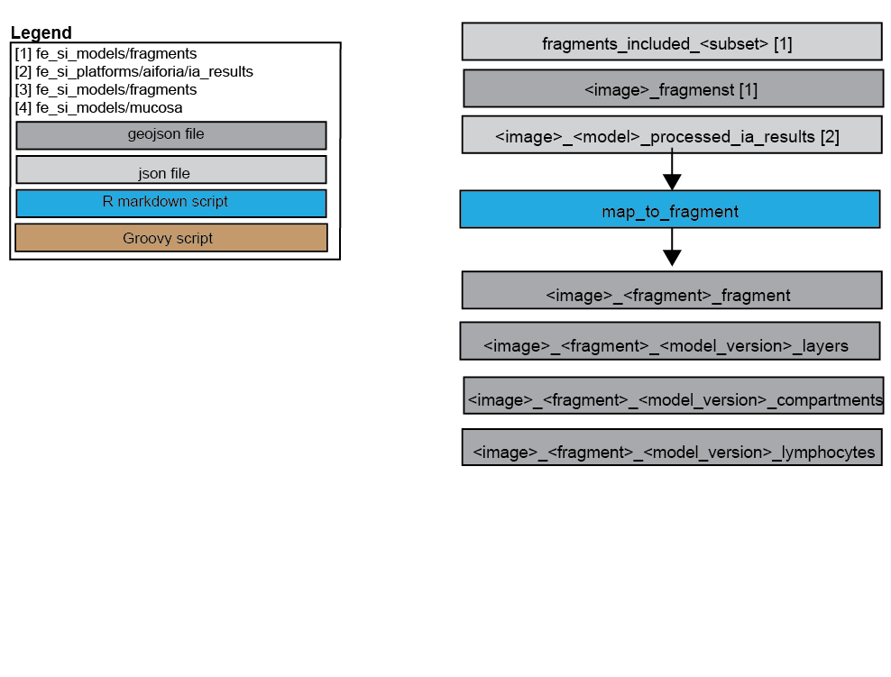

## Objective
This is to map AI model output to individual tissue fragments.

## Scripts
- **map_to_fragment.Rmd**
Maps output downloaded and processed with aiforia (fe_si_platforms/aiforia) to
fragments processed with fragments (fe_si_models/platforms)

## Deviations/ issues/ comments
This used to be in a model folder called "combos". Which I later split up.