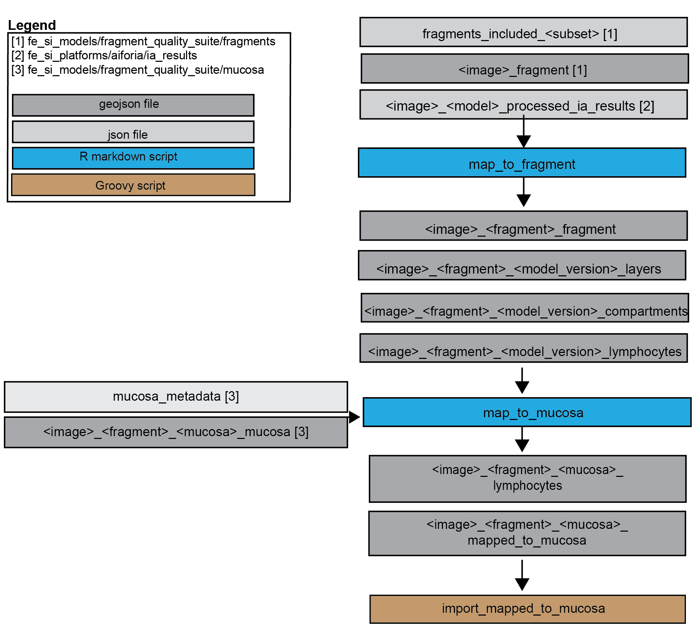

# Merge model outputs
## Objective
This folder contains scripts for mapping histology component model outputs to 
different fragments / mucosal segments. Splitting the original wsi output files up
allows processing much smaller files. 

### Scripts
- **map_to_fragment** (script that maps layers, compartment and lymphocytes output
to specific fragments)
- **map_to_mucosa** (script that maps layers, compartments and lymphocytes to specific
mucosal segments)

### Historic
Contains older pipelines for combining and mapping DL output - kept for documentation only
- **analyzeAiforiaData** (SKs old initial pipeline from 2021 and 2023 for 
processing aiforia data, no longer in use, not used for any publication)
- **quantifyAiforia** (JMWs previous version for processing aiforia data, the 
pipelines used in the "AI-based quantification ... " paper are based on this, but
more recent versions are in the fe_si_papers folder for that paper)
- **combos** (JMWs previous version of this no longer in use, not used in any 
publication)

