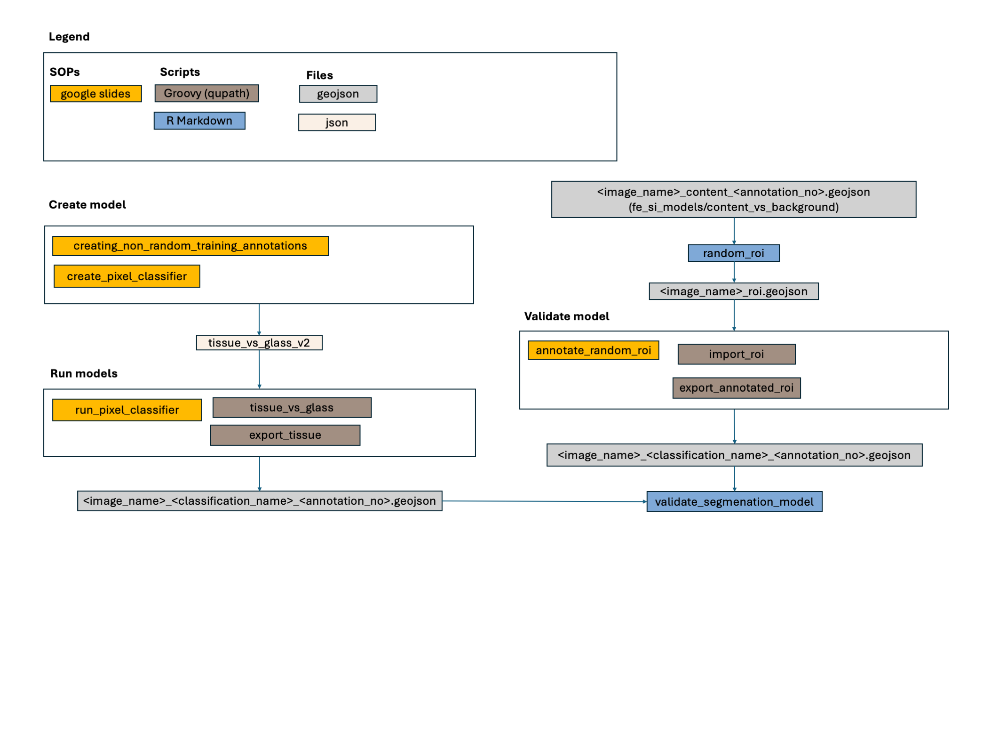

## Objective 
Separate area of a WSI with tissue (of any kind) from areas with glass (including
empty glass, pen markings, stain droplets etc)

## Intended use
- Serve as a base for separating tissue fragments (fe_si_models/fragments)

## Issues / comments / To do
- FN in areas of lipid or pale submucosa & FP in areas of stain precipitate
Not a problem for small intestinal mucosa but should be updated if analyzing deeper 
intestinal layers or other tissue.

- Run on test set - could use same validaton annoations as for the layers model
(this is alaready outlined in the overview but not done yet)

## Model architecture
- Multi-layer perceptron (MLP) (a shallow artificial neural network ANN) 
- Semantic segmentation (pixel classifier)

## Classes
- Tissue
- Glass

## Model development
SOP: <https://docs.google.com/presentation/d/1g9QMLUlkV8ITmbK1x9Ol7yW0G8M7sXVrNF_m_vysnBk/edit?usp=drive_link>

### Software
QuPath v0.5.1

### Hardware
JUDITS_PC Specs here: 
https://docs.google.com/spreadsheets/d/1Ue-r-fvt8fJIE0h0DGZL6AWinbydgwbYKjDaHcTdx3k/edit?usp=drive_link

### Development material

#### Training

##### Images
LABL_2020 WSIs <INSERT LINK>: Training set, batch 1 & 2

#### Annotations
Annotations strategy here: https://docs.google.com/spreadsheets/d/1Ue-r-fvt8fJIE0h0DGZL6AWinbydgwbYKjDaHcTdx3k/edit?usp=drive_link
<fe_si_models/tissue_vs_glass/annotations/training/tissue_vs_glass_v1>
<fe_si_models/tissue_vs_glass/annotations/training/tissue_vs_glass_v2>

##### Sample
https://github.com/ucdavis/fe_si_samples/tree/main/labl_2020
Tuning: full set
Test: Batch 1& 2

### Hyperparameters 
https://docs.google.com/spreadsheets/d/14arTrgun_KB4gPumhx4ZE5X8JcgudXyupEgvB8jFlgA/edit?usp=sharing
- setting in sheet "selecting_hyperparameters"
- selected in sheet "model_versions"

### Model versions
https://docs.google.com/spreadsheets/d/14arTrgun_KB4gPumhx4ZE5X8JcgudXyupEgvB8jFlgA/edit?usp=sharing

### Tuning assessment
https://docs.google.com/spreadsheets/d/1uXLYJ0KbuQHwRvG_OOtYaGBr4jlTv9TtmFlvYeLK7-4/edit?usp=sharing 

## Materials & methods
A draft of materials&methods for this model is here:
https://docs.google.com/document/d/1Lni-o9eW2jZ4UXC-QhvEW9tEqqR1mb3KGefZJwLDfKw/edit?usp=sharing